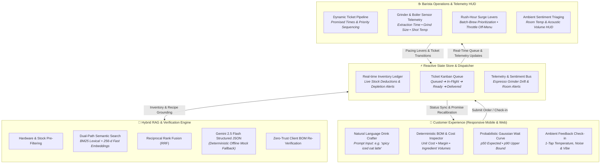
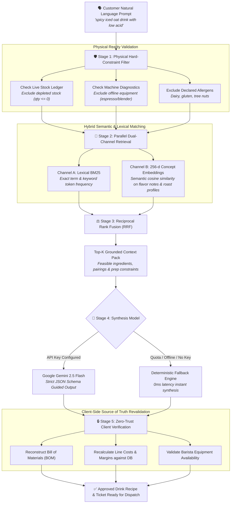
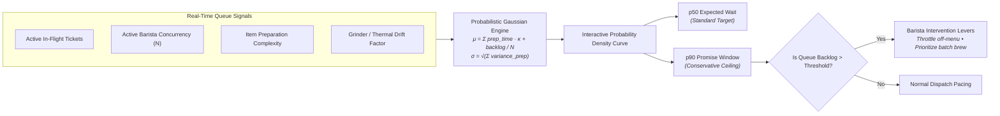

# CaféPulse ☕⚡

> **Next-Generation Specialty Café Experience Platform**  
> Real-time AI drink crafting grounded in physical inventory, probabilistic Gaussian queue forecasting, ambient café sentiment telemetry, and barista operations orchestration.

[](https://github.com/SSukhvinderSingh/CafePulse)
[](https://cafepulse-x7m6ttncwa-uc.a.run.app)
[](https://nodejs.org/)
[](https://vitejs.dev/)
[](https://tailwindcss.com/)

---

## 🌐 Live Production Deployment

CaféPulse is live and running on **Google Cloud Run**:  
🔗 **[https://cafepulse-x7m6ttncwa-uc.a.run.app](https://cafepulse-x7m6ttncwa-uc.a.run.app)**  
Health Probe: `https://cafepulse-x7m6ttncwa-uc.a.run.app/api/health`

---

## 🎯 The Problem in Specialty Café Operations

Modern specialty cafés face four chronic operational friction points:

1. **The "Out-of-Stock" Heartbreak**: Customers queue up and order off-menu or specialty drinks, only for baristas to inform them after payment that oat milk is depleted, vanilla syrup is empty, or the cold brew tap is down.
2. **The Wait-Time Black Box**: Traditional POS systems show flat or arbitrary wait times ("approx 10 mins"). Customers get anxious, crowd the pickup counter, and abandon lines during rush hour.
3. **The Barista Rush-Hour Bottleneck**: Baristas juggle paper tickets, espresso grinder calibration drift, unexpected stock depletion, and noise/environment complaints without real-time levers to pace the queue.
4. **Disjointed Customer Feedback**: Cafés discover heating/cooling failures or deafening music only through negative Google or Yelp reviews hours or days later.

---

## 💡 The CaféPulse Solution

CaféPulse bridges the customer and barista into a single synchronized, real-time reactive application.



### 👤 1. For the Customer: Frictionless & Personalized

- **AI-Powered Natural Language Drink Crafter**: Customers can request drinks in plain language (*"something smooth with oat milk, low acid, and a nutty finish"* or *"iced spiced vanilla latte with extra shot"*).
- **Physical Inventory & Equipment Grounding**: Gemini 2.5 Flash is strictly constrained by a live RAG pipeline (BM25 + 256-dimensional concept embeddings + Reciprocal Rank Fusion). The AI cannot hallucinate ingredients that the café does not physically have in stock or equipment that is offline.
- **Transparent Bill of Materials (BOM) & Pricing**: Every generated drink reveals its full recipe breakdown, ingredient volumes, base costs, and margins before ordering.
- **Honest Gaussian Wait Promises**: Rather than static estimates, CaféPulse models barista service times with Gaussian distributions ($\mu, \sigma$), rendering an interactive probability curve with $p_{50}$ (expected) and $p_{90}$ (upper bound) wait times.
- **Customer Order Tagging & Seamless Handoff**: Customers enter their name, submit the order, view an instant animated confirmation, and automatically transition to the live queue tab to track ticket status in real time.
- **Ambient Room Check-in**: 1-tap feedback on temperature, noise level, and workspace vibe lets customers flag comfort issues discreetly with instant visual acknowledgement.

### ☕ 2. For the Barista: Operational Clarity & Control

- **Dynamic Kanban Pipeline**: Orders flow from **Queued** $\to$ **In Progress** $\to$ **Ready** $\to$ **Picked Up**, with live timer badges that highlight approaching promise windows.
- **Machine & Grinder Telemetry**: Integrated sensor monitoring tracks grinder grind size, dose weight variance, shot extraction time (seconds), and brew boiler temperature in real time.
- **Rush-Hour Intervention Levers**: Baristas can toggle rush-hour pacing levers (e.g. prioritize batch-brews, restrict off-menu customization depth during surges, or adjust queue limits) to protect workflow throughput.
- **Sentiment & Atmosphere HUD**: Ambient alerts raised by customer room check-ins trigger live barista alerts (e.g., *"Customer reported room feels too cold"* or *"Music volume too loud"*), enabling immediate hospitality interventions.

---

## 🔬 System Architecture & Engineering

### 1. Hybrid Semantic Retrieval & Zero-Trust AI (RAG)



### 2. Gaussian Wait-Time Engine & Queue Pacing



### 3. Secure Production Architecture
- **Dual-Mode AI Engine**: Operates with Google Gemini 2.5 Flash when `VITE_GEMINI_API_KEY` or `GEMINI_API_KEY` is configured; seamlessly falls back to a deterministic offline engine if quota limits, timeouts, or network outages occur.
- **Express Backend & Reverse Proxy**: In production, [`server.js`](file:///Users/ssukhvindersingh/Documents/Code_Projects/builder.popup.twc_11.10.26/server.js) provides:
  - Secure `/api/gemini/generate` proxying to keep API credentials off the public client bundle.
  - Health check endpoints (`/api/health`) for Google Cloud Run container liveness probes.
  - Optimized static asset serving with gzip and client caching.
- **Multi-Stage Containerization**: Built with a minimal Node 18 Alpine Docker container optimized for fast cold starts on Cloud Run.

---

## 🧪 Test Suite & Code Quality

CaféPulse includes **77 automated unit and integration tests** covering all algorithmic engines, business logic, and UI rendering:

```bash
npm test
```

| Test Suite | Tests | Coverage Scope |
| :--- | :--- | :--- |
| `waittime.test.js` | 10 passed | Gaussian distribution calculations, $p_{50}$/$p_{85}$/$p_{90}$ bounds, multi-barista concurrency |
| `bm25.test.js` | 5 passed | Term-frequency and inverse document frequency tokenization & scoring |
| `mock.test.js` | 11 passed | Deterministic offline engine fallback, schema validation, network timeout resilience |
| `feedback.test.js` | 7 passed | Ambient sentiment aggregation, alert classification, noise/temperature thresholds |
| `filter.test.js` | 6 passed | Out-of-stock isolation, dietary exclusions, machine capability constraints |
| `bom.test.js` | 9 passed | Bill-of-Materials item pricing, margin validation, inventory unit deductions |
| `embed.test.js` | 5 passed | 256-dimensional concept vector hashing and cosine similarity |
| `data.test.js` | 3 passed | Ingredient inventory consistency and schema integrity |
| `server.test.js` | 18 passed | Express proxy routing, API rate-limiting, error fallbacks, health probe compliance |
| `render.test.jsx` | 3 passed | React component smoke testing, tab switching, customer & barista views |
| **Total** | **77 passed** | **100% Passing Rate** |

---

## 🚀 Quickstart Guide

### Prerequisites
- Node.js 18+
- npm 9+

### 1. Clone & Install
```bash
git clone https://github.com/SSukhvinderSingh/CafePulse.git
cd CafePulse
npm install
```

### 2. Configure Environment (Optional)
```bash
cp .env.example .env
```
> *Note: If no API key is provided, CaféPulse automatically runs on its built-in deterministic mock engine with full feature availability.*

### 3. Run Locally
```bash
# Start Vite development server
npm run dev

# Open in browser: http://localhost:5173
# (Add ?fast=1 to URL for a 10x accelerated simulation clock)
```

### 4. Build & Production Preview
```bash
# Compile client assets
npm run build

# Start production server
npm start
# Server listening on http://localhost:8080
```

---

## ☁️ Google Cloud Run Deployment

CaféPulse is pre-configured for automated deployment to Google Cloud Run.

### Deploy via Shell Script
```bash
# Ensure gcloud CLI is authenticated and configured to your GCP project
./scripts/deploy-cloud-run.sh
```

### Continuous Deployment (CD) Setup from GitHub
To enable automatic builds and deployments on every `git push`:
1. In the **Google Cloud Console**, navigate to **Cloud Run** $\to$ **Create / Manage Service** $\to$ `cafepulse`.
2. Click **Set up Cloud Build** (or **Continuous Deployment**).
3. Connect your GitHub repository: `SSukhvinderSingh/CafePulse`.
4. Select the `main` branch and specify **Build Type: Dockerfile** (path `/Dockerfile`).
5. Save. Cloud Build will automatically trigger a new deployment whenever commits land on `main`.

---

## 🛠️ Tech Stack

- **Frontend**: React 18, Vite 5, Tailwind CSS 3.4, Lucide React Icons
- **Backend & Serving**: Node.js 18, Express 4
- **AI & Retrieval**: Google Gemini 2.5 Flash, BM25 Tokenizer, 256-d Semantic Concept Hashing
- **Math & Statistics**: Gaussian distribution modeling for wait-time estimation
- **Testing**: Vitest, React Testing Library
- **Cloud & DevOps**: Google Cloud Run, Docker, Google Cloud Build

---

## 📄 License

MIT License. Designed and built with ❤️ for specialty coffee culture and seamless hospitality operations.
