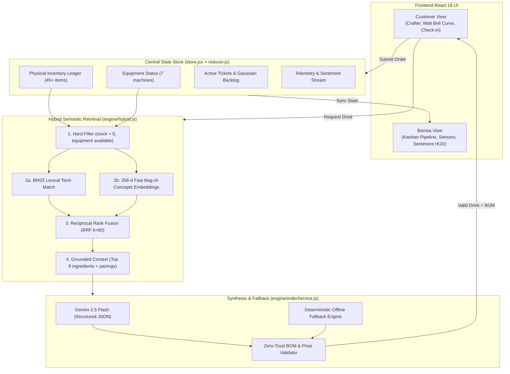

# CaféPulse — PRD & Architecture (SA2)

## 0. Locked assumptions (defaults chosen; no blocking doubts)
| # | Assumption |
|---|---|
| A1 | Language: **JavaScript + JSDoc** (ESM), React 18 + Vite 5 + **Tailwind 3.4** (postcss, autoprefixer), lucide-react, **hand-rolled SVG charts** (no Recharts; fewer deps, full control of bell curve). Recharts optional, not required. |
| A2 | Gemini: model `gemini-2.5-flash`, called via **REST `fetch`** (no SDK dep) to `https://generativelanguage.googleapis.com/v1beta/models/gemini-2.5-flash:generateContent` with `responseMimeType: application/json` + `responseSchema`. Key from `VITE_GEMINI_API_KEY`. |
| A3 | No backend. Key in client is demo-only; Cloud Run proxy documented as future work (README). Deploy not in scope. |
| A4 | Customer view rendered inside a 390×844 phone-frame on desktop; full-bleed on <480px. |
| A5 | State persisted in `localStorage` key `cafepulse.v1`; header "Reset demo" button restores seed. |
| A6 | No key / any failure (network, timeout 6s, non-200, schema-invalid JSON) -> **mock engine silently** (badge shows `Mock` or `Gemini`). Mock is synchronous-fast (<5 ms, wrapped in resolved Promise). |
| A7 | Single-tab; "barista" and "customer" are one shared store (same React context), toggled by a header switch. Cross-tab sync out of scope. |
| A8 | Currency USD. Time unit minutes. Simulated clock ticks every 1s (countdowns); `?fast=1` ticks 10x for demos. |
| A9 | No auth, no real payments. Orders are simulated. |

Non-goals: backend, auth, payments, multi-store, real POS, cloud deploy, cross-device sync, i18n.

## 1. User stories
- Customer: type "something fruity, oat milk, not too sweet" -> get ranked in-stock candidates and a custom drink with BOM, price, prep time; place order; see wait bell curve with my pin, progress tracker; use "shift-left" levers to cut wait; 1-tap room feedback.
- Barista: see ticket pipeline with countdowns; toggle ingredients out/in stock; see room sentiment gauge + live alerts; see queue bell curve and apply intervention levers.

## 2. Architecture



```
src/
  main.jsx, App.jsx, index.css
  data/ ingredients.js (45+), equipment.js, recipes.js (base ratios), pairings.js (pairing guidelines + flavor wheel docs),
        seedTickets.js, seedTelemetry.js, schemas.js (JSDoc typedefs + validators)
  engine/ filter.js (deterministic stock+equipment)
          tokenize.js, bm25.js, embed.js, hybrid.js (RRF fusion + retrieval pipeline)
          gemini.js (live call + validator), mock.js (deterministic order synth), orderService.js (live->mock fallback)
          bom.js (BOM pricing, deduction)
          waittime.js (Gaussian model, erf, invNorm, levers)
          feedback.js (aggregate, mock classifier), classifier.js (live->mock)
  state/ store.jsx (useReducer + context + localStorage + clock), reducer.js, selectors.js
  components/ shared/ (Header, ViewToggle, Badge, PhoneFrame, BellCurve, Gauge, Radar)
              customer/ (OrderBar, OffMenuCrafter, InventoryBadge, WaitPanel, ProgressTracker, FeedbackCheckin, ShiftLeftLevers)
              barista/ (TicketPipeline, InventoryManager, SentimentPanel, AlertHud, QueueAnalytics, InterventionLevers)
  test/ *.test.js (vitest)
```
Dev deps: vitest. Scripts: `dev`, `build`, `preview`, `test` (`vitest run`).
Flow: user text -> `orderService.craft(query, state)` -> filter (stock>0 & equipment available) -> BM25 + dense over docs restricted to feasible items -> RRF -> top-k context -> Gemini (or mock) returns JSON order -> `validateOrder` (all BOM items must be feasible & stock sufficient, else repair/mock) -> user confirms -> reducer `PLACE_ORDER`: deduct inventory atomically, create ticket, recompute queue stats.

## 3. Data schemas
```
Ingredient {id, name, category:'espresso|milk|syrup|fruit|spice|tea|topping|base', unit:'g|ml|shot|pc', stock:number, parLevel, costPerUnit, pricePerUnit, tags:{taste:[], dietary:[], notes:[]}, requiresEquipment:[equipmentId], flavorNotes:string}
Equipment {id, name, available:boolean}   // espresso-machine, steam-wand, grinder, blender, cold-brew-tap, kettle, shaker
Recipe {id, name, baseRatio:[{ingredientId, qty}], method, prepMinutes, basePrice, text}
PairingDoc {id, kind:'pairing|flavor-wheel|ratio', text, tags:[]}
BOMLine {ingredientId, name, qty, unit, unitCost, lineCost}
CustomOrder {name, description, bom:BOMLine[], price, cost, baristaSteps:string[], prepMinutes, allergens:string[], source:'gemini|mock'}
Ticket {id, customer, orderName, bom, price, prepMinutes, createdAt, startedAt|null, dueAt, status:'queued|brewing|ready|done', source}
Telemetry {id, ts, temperature(1-5), noise(1-5), cleanliness(1-5), seating(1-5), coffee(1-5), comment?}
Alert {id, ts, category:'temperature|noise|cleanliness|seating|coffee|other', severity:'low|med|high', message, suggestedAction}
State {inventory{id:stock}, equipment{id:bool}, tickets[], telemetry[], alerts[], view:'customer|barista', baristas:number(default 1), interventions[], now, myTicketId}
```
Seed: ≥45 ingredients (≥6 espresso/base, 8 milks/alt, 10 syrups, 8 fruit/spice, 5 tea, 5 toppings, with 3 at stock 0 and 3 low stock), 7 equipment (1 unavailable e.g. blender default available, cold-brew-tap=false), 6 base recipes, ≥20 pairing/flavor-wheel docs, 6 active tickets (staggered statuses), 12 telemetry points with 1-2 poor.

## 4. Algorithms
**Deterministic filter**: ingredient eligible iff `stock>0` and every `requiresEquipment` is available. Recipe eligible iff all baseRatio ingredients eligible. Returns eligible sets used by all retrieval (retrieval never sees ineligible items).

**Tokenize**: lowercase, split `[^a-z0-9]+`, drop stopwords, light stemmer (strip `ing|ed|es|s|y->i`), keep tag tokens.

**BM25** (lexical) over ingredient/recipe documents built from `name + taste + dietary + notes tags`: `score = Σ idf(q)·tf·(k1+1)/(tf+k1·(1-b+b·dl/avgdl))`, k1=1.5, b=0.75, `idf=ln(1+(N-df+0.5)/(df+0.5))`. Dietary tokens in the query (vegan, dairy-free, gluten-free, nut-free, sugar-free) act as **hard filters** via dietary tags, not merely scoring.

**Dense (bag-of-concepts hashed embedding, 256-d)** over PairingDocs, flavor-wheel docs, recipe ratio text: tokens + bigrams expanded through a concept lexicon (e.g. fruity->[berry,citrus,bright,acid]; cozy->[cinnamon,vanilla,warm]; sweet->[caramel,honey]) ; each feature FNV-1a hashed to bucket with sign from second hash bit; weight `1+ln(tf)`; L2-normalised; cosine similarity. Deterministic, no deps; documented as stand-in for `text-embedding-004`.

**Fusion**: Reciprocal Rank Fusion `Σ 1/(60+rank)` over BM25 list and dense list, take top 8 ingredients + 3 pairing docs + best base recipe as context.

**Gaussian wait-time** (m = baristas, tickets ahead i with remaining minutes r_i, plus own prep p):
- `mu = (Σ r_i)/m·κ + p`, κ=1 (batching lever lowers). Remaining r_i = prepMinutes minus elapsed if brewing.
- per-ticket sd `s_i = 0.25·r_i + 0.3`; `sigma = sqrt(Σ s_i² + (0.25p+0.3)²)/sqrt(m)`; floor sigma at 0.5.
- `pdf(x)=exp(-(x-mu)²/2σ²)/(σ√2π)`; `cdf(x)=0.5(1+erf((x-mu)/(σ√2)))` with Abramowitz-Stegun 7.1.26 erf; `quantile(p)=mu+σ·z_p`, z_p from Acklam inverse normal. Percentiles reported: P50,P85,P95. Truncate display at x>=0.
- **Order pin**: promised time `T=quantile(0.85)` rounded up to whole minute (e.g. "16 min · 85th pct"). Pin on curve at T; progress tracker uses elapsed/T.
- **Customer shift-left levers** (each returns Δmu, Δsigma applied to *own* prep p and recomputes): simplify (drop 1 add-on: p−0.7), skip off-menu (use base recipe: p×0.7), mobile-pay/pre-order (p−0.5), choose lower-queue window (−10% Σr). Applied levers shown with "−N min" chip.
- **Barista levers**: add barista (m+1), batch similar drinks (κ=0.9), pause off-menu orders (own-extras removed, sigma×0.85), prioritise ready-to-go. Shows before/after mu, P85.

**Inventory deduction**: `PLACE_ORDER` is atomic; reject if any `stock<qty`; otherwise subtract. Restock toggle sets stock to parLevel (on) or 0 (off).

**Feedback classification**: live Gemini returns `{category,severity,message,suggestedAction}`; mock rules: score≤2 on a dimension -> alert for that category (≤1 high, 2 med); comment keywords (cold, loud, sticky, crowded, bitter) map to category; 3+ lows within 10 min on same category escalates severity. Sentiment gauge = mean of last 10 normalised 0-100.

## 5. Mock-vs-live fallback
`orderService.craft`: if no key -> mock. Else `Promise.race([geminiCall, timeout 6s])`, JSON.parse, `validateOrder`; on any throw/invalid -> mock result with `source:'mock'`. Same for classifier. Mock order synth: chooses best-ranked eligible base recipe, swaps in top-ranked eligible modifiers per query tags (milk alt, syrup, spice), recalculates BOM = Σ qty·pricePerUnit, price = cost×3.2 rounded to .25 (min basePrice), prepMinutes = recipe prep + 0.5/extra, steps templated. Never makes network calls; never throws. UI badge reveals source. No key is ever logged.

## 6. Acceptance criteria (numbered)
1. `npm install && npm run build` succeeds; `npm run dev` serves app with no console errors.
2. `npm test` passes; includes unit tests for filter, BM25, embed, RRF, waittime, bom/deduction, mock, fallback.
3. Seed has ≥40 ingredients, ≥5 equipment, ≥6 base recipes, ≥15 pairing docs, ≥5 active tickets, ≥10 telemetry rows.
4. Ingredient with stock 0 or missing equipment never appears in retrieval results nor any generated BOM (test with ingredient forced to 0).
5. BM25: query "citrus vegan" ranks a doc tagged both above a doc with only one; idf/length-norm verified with a handcrafted corpus.
6. Embed: deterministic (same text -> identical vector), unit norm, cosine("fruity bright","citrus berry") > cosine("fruity bright","smoky chocolate").
7. Without `VITE_GEMINI_API_KEY`, ordering returns a valid CustomOrder in <50 ms with `source:'mock'`; with a key and a forced fetch failure (test mock of fetch) it falls back identically.
8. CustomOrder contains BOM (≥2 lines), price>0, ≥3 barista steps, prepMinutes>0; BOM costs sum to `cost`.
9. Placing an order reduces each BOM ingredient's stock by exactly qty, adds a Ticket, persists to localStorage; reload keeps it; "Reset demo" restores seed.
10. Order exceeding available stock is rejected with visible message and no partial deduction.
11. Inventory badge on crafter shows in-stock/low/out per ingredient (colour+text, not colour only).
12. waittime: `cdf(mu)=0.5±1e-6`; `quantile(0.5)=mu`; `quantile(0.8413)≈mu+σ` (±0.01σ); `cdf(quantile(p))≈p` for p∈{.05,.5,.85,.95} (±1e-3); erf error <1.5e-7.
13. Bell curve SVG shows mu line, shaded to P85, pin labelled "{T} min · 85th pct", and updates when a ticket is added or a lever toggled.
14. Each customer shift-left lever lowers mu (or P85) vs baseline; barista add-barista lowers both mu and sigma; before/after values displayed.
15. Customer progress tracker advances Queued->Brewing->Ready driven by clock; countdown never negative.
16. 1-tap feedback: 5 dimensions (temperature, noise, cleanliness, seating vibe, coffee rating) record a Telemetry row on one tap each; submit adds an entry within 1 interaction.
17. A feedback of score ≤2 produces an Alert in the barista HUD (mock classifier) with category, severity, suggested action; ≥3 similar escalates severity; barista can dismiss.
18. Header toggle switches customer<->barista in one click without losing state; customer view in phone frame.
19. Barista dashboard has: ticket pipeline with live countdowns & status advance buttons, inventory manager with restock toggles (affects customer crafter instantly), sentiment gauge + alerts, queue bell curve with intervention levers.
20. Status badge shows `Gemini` vs `Mock` source on orders and alerts.
21. Responsive: customer view usable at 360px width; barista at ≥1024px; keyboard focus visible; buttons have labels/aria; contrast AA on text.
22. README documents setup, env var, mock fallback, assumptions, and future Cloud Run proxy.
23. No API key committed; `.env.example` provided; `.gitignore` includes `.env*`.

## 7. Implementation plan (SA3)
1. Scaffold manually (package.json, vite.config.js, tailwind/postcss configs, index.html). `npm install react react-dom lucide-react`; dev: `vite @vitejs/plugin-react tailwindcss@3.4 postcss autoprefixer vitest`. If registry 403s, retry with sandbox bypass.
2. data/*, then engine/* with tests (run `npx vitest run` after each).
3. state/*, then shared components (BellCurve, Gauge, Radar SVG), customer view, barista view, header toggle.
4. Visual design per frontend-design/antislop skills: distinct warm-espresso palette, no generic purple gradients; one display + one text font; skip over-engineering (ponytail).
5. README, .env.example; run `npm test && npm run build`; smoke-run dev server.
